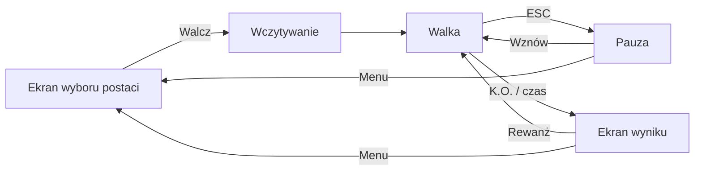

# Bijatyka

Pixel-artowa bijatyka w przeglądarce: **gracz vs bot**. React odpowiada za UI,
a sama walka działa na własnym silniku Canvas 2D z zachowaniem ostrych pikseli.

## Stack

| Warstwa | Technologia | Dlaczego |
|---|---|---|
| Build | Vite 8 | Natychmiastowy HMR, zero konfiguracji |
| UI | React 19 + TypeScript | Ekran wyboru postaci, pauza, HUD, przyciski dotykowe |
| Silnik walki | Własny Canvas 2D | Pełna kontrola nad hitboxami i frame data |
| Audio | WebAudio API | Twoje pliki + proceduralne SFX jako fallback |
| Font | Pixelify Sans (lokalnie) | Pixel-artowy kroj dla UI i HUD-u |
| Styl | Czysty CSS | Bez zależności, pixel-artowa estetyka |

Gra rysowana jest w **rozdzielczości logicznej 640×360 px**, a następnie skalowana
w górę tak, aby wypełnić okno (np. ×2.5 przy 1600×900, ×3 przy 1920×1080).
`image-rendering: pixelated` w CSS utrzymuje ostre, kwadratowe piksele.

> **Dlaczego nie 1280×720?** Większa rozdzielczość logiczna *zmniejszyłaby* obraz.
> Przy 640×360 na monitorze 1080p skala to ×3, a przy 1280×720 byłaby to już ×1 —
> postacie zajmowałyby tę samą liczbę pikseli ekranu, ale straciłyby ostrość,
> bo sprite'y (1024 px na klatkę) byłyby downsample'owane. Rozdzielczość logiczna
> to rozmiar *piksela artystycznego*, nie liczba pikseli ekranu.

**Pixel art vs ilustracje.** Sprite'y postaci są pixel artem i rysowane są
z `imageSmoothingEnabled = false`. Portrety i tła to natomiast ilustracje
(80–180 tys. kolorów, miękkie krawędzie) — one są rysowane **z wygładzaniem**,
bo przy nearest-neighbour zmniejszenie 1024 px do 54 px zamieniałoby je w szum.
Widać to w [renderer.ts](src/game/core/renderer.ts) — `drawImage(..., smooth)`
oraz `drawWorldSlice(..., smooth)`.

## Przepływ gry



## Uruchomienie

```bash
npm install
npm run dev      # http://localhost:5173
npm run build    # typecheck + build produkcyjny
npm run typecheck
```

Gra działa **od razu** bez żadnych grafik — brakujące pliki są zastępowane
proceduralnymi odpowiednikami. Gdy wrzucisz własne, zostaną użyte automatycznie.

## Sterowanie

| Klawisz | Akcja |
|---|---|
| `A` / `D` | Ruch (do przodu / do tyłu) |
| `W` | Skok |
| `S` | Kucanie |
| `J` | Cios lekki |
| `K` | Cios ciężki |
| `L` | Atak specjalny (pocisk, koszt 25 energii) |
| `Spacja` / `Shift` | Blok |
| `ESC` | Pauza |
| `Enter` | Wznowienie (w pauzie) |

Obsługiwany jest też **gamepad** (lewy drążek + przyciski) oraz **wirtualne
przyciski dotykowe** (przełącznik w prawym górnym rogu).

## Wybór postaci

Gra zaczyna się od ekranu wyboru, na którym przypisujesz postacie do dwóch
slotów — **GRACZ** i **BOT** — oraz wybierasz poziom trudności.

- Kliknij zakładkę slotu, aby wybrać, któremu przypisujesz postać.
- Kliknij portret, aby przypisać go do aktywnego slotu.
- Ten sam portret nie może trafić do obu slotów — druga postać przełączy się
  automatycznie na wolną.

---

## Grafiki postaci

### Format: równa siatka

Każdy spritesheet to zwykły PNG z siatką klatek o stałym rozmiarze.
Domyślnie: **klatka 224×192 px**, **8 kolumn**, **14 wierszy**.

Taki rozmiar klatki sprawia, że postać zajmuje **połowę wysokości ekranu gry**
(180 px z 360 px). Szerokość 224 px musi pomieścić najszerszą pozę — wyciągnięty
cios sięga ok. 104 px od nóg, więc węższa klatka ucinałaby rękę.

```
        kol 0    kol 1    kol 2    kol 3    kol 4    kol 5    kol 6    kol 7
row  0  idle     idle     idle     idle     ─        ─        ─        ─
row  1  walkF    walkF    walkF    walkF    walkF    walkF    ─        ─
row  2  walkB    walkB    walkB    walkB    walkB    walkB    ─        ─
row  3  crouch   crouch   ─        ─        ─        ─        ─        ─
row  4  jump     ─        ─        ─        ─        ─        ─        ─
row  5  light    ─        ─        ─        ─        ─        ─        ─
row  6  heavy    ─        ─        ─        ─        ─        ─        ─
row  7  special  special  special  special  special  special  ─        ─
row  8  block    ─        ─        ─        ─        ─        ─        ─
row  9  hit      ─        ─        ─        ─        ─        ─        ─
row 10  down     down     down     down     down     ─        ─        ─
row 11  victory  victory  victory  victory  victory  victory  ─        ─
row 12  defeat   defeat   defeat   defeat   ─        ─        ─        ─
row 13  air      ─        ─        ─        ─        ─        ─        ─
```

Puste komórki po prawej są ignorowane — nie musisz ich wypełniać.

### Pliki do dostarczenia

| Plik | Rola | Status |
|---|---|---|
| `public/assets/sprites/c1.png` | Spritesheet postaci 1 (Sheeva) | do dostarczenia |
| `public/assets/sprites/c2.png` | Spritesheet postaci 2 (Jade) | do dostarczenia |
| `public/assets/sprites/c1/walk.png` | Cykl chodu postaci 1 (2×2 klatki) | ✔ dostarczony |
| `public/assets/sprites/c2/walk.png` | Cykl chodu postaci 2 (2×2 klatki) | ✔ dostarczony |
| `public/assets/sprites/c1/idle.png` | Bezruch postaci 1 (2×2 klatki) | ✔ dostarczony |
| `public/assets/sprites/c2/idle.png` | Bezruch postaci 2 (2×2 klatki) | ✔ dostarczony |
| `public/assets/sprites/c1/jump.png` | Skok postaci 1 (1 klatka) | ✔ dostarczony |
| `public/assets/sprites/c2/jump.png` | Skok postaci 2 (1 klatka) | ✔ dostarczony |
| `public/assets/sprites/c1/block.png` | Blok postaci 1 (1 klatka) | ✔ dostarczony |
| `public/assets/sprites/c2/block.png` | Blok postaci 2 (1 klatka) | ✔ dostarczony |
| `public/assets/sprites/c1/punch1.png` | Lekki cios postaci 1 (1 klatka) | ✔ dostarczony |
| `public/assets/sprites/c2/punch1.png` | Lekki cios postaci 2 (1 klatka) | ✔ dostarczony |
| `public/assets/sprites/c1/punch2.png` | Ciężki cios postaci 1 (1 klatka) | ✔ dostarczony |
| `public/assets/sprites/c2/punch2.png` | Ciężki cios postaci 2 (1 klatka) | ✔ dostarczony |
| `public/assets/sprites/c1/hit.png` | Otrzymanie ciosu przez postać 1 (1 klatka) | ✔ dostarczony |
| `public/assets/sprites/c2/hit.png` | Otrzymanie ciosu przez postać 2 (1 klatka) | ✔ dostarczony |
| `public/assets/sprites/c1/airkickc1.png` | Cios w powietrzu postaci 1 (1 klatka) | ✔ dostarczony |
| `public/assets/sprites/c2/airkickc2.png` | Cios w powietrzu postaci 2 (1 klatka) | ✔ dostarczony |
| `public/assets/portraits/c1.png` | Portret do ekranu wyboru | ✔ dostarczony |
| `public/assets/portraits/c2.png` | Portret do ekranu wyboru | ✔ dostarczony |
| `public/assets/portraits/c1_0..c1_3.png` | Portrety obrażeń postaci 1 (0 = nietknięta) | ✔ dostarczony |
| `public/assets/portraits/c2_0..c2_3.png` | Portrety obrażeń postaci 2 (0 = nietknięta) | ✔ dostarczony |

Pełny spritesheet: **1792×2688 px** (8 × 224 szerokości, 14 × 192 wysokości).

> **Dopóki nie dostarczysz pełnych spritesheetów**, animacje bez własnego pliku
> korzystają z portretu (postać widoczna, ale bez ruchu). Animacje dostarczone
> osobno — jak chód — działają normalnie.

### Animacje dostarczane pojedynczo

Animację można dostarczyć jako osobny plik, bez czekania na cały arkusz.
Wystarczy wpis w `animationSheets` w
[characters.ts](src/game/config/characters.ts):

```ts
animationSheets: {
  idle:        { sheet: '/assets/sprites/c1/idle.png', columns: 2, rows: 2 },
  walkForward: { sheet: '/assets/sprites/c1/walk.png', columns: 2, rows: 2 },
  walkBack:    { sheet: '/assets/sprites/c1/walk.png', columns: 2, rows: 2 },
  jump:        { sheet: '/assets/sprites/c1/jump.png', columns: 1, rows: 1 },
  block:       { sheet: '/assets/sprites/c1/block.png', columns: 1, rows: 1 },
  lightAttack: { sheet: '/assets/sprites/c1/punch1.png', columns: 1, rows: 1 },
  heavyAttack: { sheet: '/assets/sprites/c1/punch2.png', columns: 1, rows: 1 },
  hit:         { sheet: '/assets/sprites/c1/hit.png', columns: 1, rows: 1 },
  airAttack:   { sheet: '/assets/sprites/c1/airkickc1.png', columns: 1, rows: 1 },
},
```

Liczba klatek w `ANIM_LAYOUT` musi się zgadzać z liczbą klatek w pliku
(`columns × rows`), inaczej animacja migałaby pustymi klatkami. Dlatego `jump`,
`block`, `lightAttack`, `heavyAttack`, `hit` i `airAttack` mają po **1 klatce**
— są dostarczone jako pojedyncze obrazki.

Klatki mogą leżeć w dowolnej siatce (`columns` × `rows`) — loader czyta je
wierszami (lewo→prawo, potem następny wiersz) i składa w jeden poziomy rząd
wewnątrz arkusza postaci. Reszta kodu nie widzi różnicy.

**Rozmiar postaci** jest wyliczany z obrysu sylwetki: najwyższa klatka cyklu
jest skalowana do `bodyH` (180 px), a jej stopy trafiają na `originY`. Wszystkie
klatki dostają **tę samą skalę**, więc postać nie skacze w trakcie animacji.

**Poziome zakotwiczenie** to środek bioder, a nie środek obrysu. Przy ciosie
wyciągnięta ręka przesuwa obrys o ponad 100 px w bok — gdyby klatka była
centrowana obrysem, postać uciekałaby z klatki i kończyna byłaby ucinana.
Biodra (pas 45–58% wysokości sylwetki) stoją w miejscu niezależnie od pozy.
Dolny pas nóg odpada, bo przy kopnięciu z powietrza trafia w wyciągniętą nogę.

Jeśli chcesz mieć pewność, że kilka osobnych arkuszy da identyczny rozmiar
postaci, podaj `scale` jawnie (np. `scale: 0.389`) — wtedy obrys nie jest mierzony.

> Arkusze animacji muszą mieć **prawdziwą przezroczystość** (kanał alfa).
> Plik z wypełnionym tłem (np. JPEG albo PNG bez alfy) zostanie narysowany
> razem z tłem — patrz „Najczęstsze problemy”.

### Punkt zaczepienia

Postać jest pozycjonowana **stopami**. Stopa znajduje się w punkcie `(112, 188)`
wewnątrz klatki 224×192 — czyli 4 px nad dolną krawędzią. Zostaw te 4 px
marginesu, żeby stopy nie były przycięte.

### Zmiana rozmiaru klatki

Jeśli użyjesz innego rozmiaru, zmień w
[characters.ts](src/game/config/characters.ts):

```ts
export const FRAME_W = 224;
export const FRAME_H = 192;
export const FOOT_MARGIN = 4;
```

`originX` i `originY` wyliczają się automatycznie (`FRAME_W / 2` oraz
`FRAME_H - FOOT_MARGIN`). Pamiętaj też o `bodyW`/`bodyH` — to pudełko kolizyjne
liczone od stóp. Klatka musi być **symetryczna względem `originX`**, inaczej
odbicie lustrzane przesuwa postać w bok.

### Portrety przy pasku życia

Obok paska HP rysowany jest **cały portret** postaci (54×81 px, proporcja 2:3
jak grafiki). Wraz z otrzymywanymi obrażeniami portret się zmienia — lista
`damagePortraits` idzie od stanu nietkniętego do najmocniej obitego:

```ts
damagePortraits: [
  '/assets/portraits/c1_0.png',  // pełne zdrowie
  '/assets/portraits/c1_1.png',
  '/assets/portraits/c1_2.png',
  '/assets/portraits/c1_3.png',  // blisko nokautu
],
```

Pasek zdrowia dzielony jest na tyle progów, ile jest portretów — przy czterech
grafikach twarz zmienia się po przekroczeniu kolejnej czwiatrki HP. Portret bota
jest odbijany lustrzanie, żeby twarz była zwrócona w stronę jego paska.

Brak wpisu albo nieudane wczytanie grafiki nie psuje HUD — używany jest wtedy
zwykły `portrait`.

### Zmiana układu animacji

Liczbę klatek, wiersz, kolumnę początkową i tempo odtwarzania ustawisz w
`ANIM_LAYOUT` w [characters.ts](src/game/config/characters.ts):

```ts
idle: { row: 0, startCol: 0, frames: 4, fps: 8, loop: true },
```

- `row` — wiersz w arkuszu (liczony od 0)
- `startCol` — kolumna pierwszej klatki (przydatne przy arkuszu 4×4)
- `frames` — ile klatek odtwarzać
- `fps` — tempo odtwarzania
- `loop` — czy animacja się zapętla

Konfiguracja jest walidowana przy starcie — jeśli klatki wychodzą poza arkusz,
ostrzeżenie pojawi się w konsoli przeglądarki.

### Paleta kolorów

Kolory w `palette` służą wyłącznie do generowania grafiki zastępczej. Ustaw je
blisko kolorów swojej postaci, żeby placeholder wyglądał sensownie.

---

## Tło i ulica

Arena składa się z dwóch niezależnych grafik:

| Plik | Rola | Rozmiar |
|---|---|---|
| `public/assets/backgrounds/bgr.jpg` | **Nieruchome tło** — nie rusza się przy przewijaniu | dowolny (skalowany „cover”) |
| `public/assets/backgrounds/road.jpg` | **Ulica** — rozciągnięta na całą szerokość świata, przewijana z kamerą | dowolny (bardzo szeroki) |

Kamera podąża za środkiem walki wewnątrz świata o szerokości **1280 px**
(`WORLD_WIDTH`), pokazując okno 640 px. Gdy postacie idą w prawo, ulica
przesuwa się pod nimi, a tło pozostaje nieruchome — to daje wrażenie marszu
w głąb ulicy.

Wysokość ulicy na ekranie wyliczana jest **z proporcji grafiki**, więc podmiana
`road.jpg` na inny plik nie zniekształci jej. Szerokość świata zmienisz w
[constants.ts](src/game/constants.ts):

```ts
export const WORLD_WIDTH = 1280;   // im większe, tym dłuższa ulica
```

---

## Dźwięk

Osiem efektów + muzyka w `public/assets/audio/`:

| Plik | Kiedy odtwarzany |
|---|---|
| `light.mp3` | Cios lekki |
| `heavy.mp3` | Cios ciężki |
| `special.mp3` | Atak specjalny |
| `block.mp3` | Zablokowany cios |
| `hit.mp3` | Trafienie |
| `ko.mp3` | Nokaut |
| `jump.mp3` | Skok |
| `ui.mp3` | Interfejs |
| `music.mp3` | Muzyka w tle (zapętlona) |
Obsługiwane formaty: `.mp3`, `.ogg`, `.wav` — zmień rozszerzenia w
[audio.ts](src/game/assets/audio.ts) (`SFX_FILES`, `MUSIC_FILE`).

**Brak plików nie jest błędem.** Efekty są wtedy syntezowane proceduralnie przez
WebAudio, a muzyka po prostu nie gra.

> Przeglądarki blokują dźwięk do pierwszego gestu użytkownika. Audio startuje
> po kliknięciu „Start walki”.

---

## Mechanika walki

### Frame data

Wszystkie ataki mają trzy fazy: **startup → active → recovery**. Hitbox jest
aktywny wyłącznie w fazie `active` i może trafić tylko raz na atak.

| Atak | Startup | Active | Recovery | Obrażenia | Koszt |
|---|---|---|---|---|---|
| Lekki (`J`) | 4 kl. | 3 kl. | 8 kl. | 5 | — |
| Ciężki (`K`) | 9 kl. | 4 kl. | 17 kl. | 11 | — |
| Specjalny (`L`) | 13 kl. | 2 kl. | 24 kl. | 9 (pocisk) | 25 energii |
Wartości zmienisz w [balance.ts](src/game/config/balance.ts).

### Stany

`idle`, `walkForward`, `walkBack`, `crouch`, `jump`, `attack`, `block`, `hit`,
`knockdown`, `victory`, `defeat`.

Po trafieniu postać wchodzi w **hitstun** (nie może działać). Po zablokowaniu —
w **blockstun** (krótszy). Blok działa tylko, gdy postać **patrzy w stronę
atakującego** — atak od tyłu jest nie do obrony.

### Zwrot w stronę przeciwnika

Postać **zawsze** obraca się w stronę przeciwnika — także **w powietrzu**, więc
po przeskoczeniu nad nim odwraca się w locie. Obrót jest zablokowany w trakcie
ataku, hitstunu i nokdaunu, żeby animacja nie „szarpała” postacią.

### Przeskakiwanie nad przeciwnikiem

Pushbox (odpychanie sylwetek) działa **tylko wtedy, gdy obie postacie stoją na
ziemi**. Gdy choć jedna jest w powietrzu, sylwetki się przenikają — inaczej skok
nad przeciwnikiem byłby niemożliwy, bo pushbox wypychałby skaczącego na bok.

Skok trwa ok. 27 klatek i przy `AIR_SPEED = 3.2` daje ok. 85 px zasięgu, co z
zapasem wystarcza do przeskoczenia (minimalna separacja to 56 px). Wysokość
skoku to ok. 133 px, a nad głową postaci zostaje 150 px — mieści się swobodnie.

> Jeśli chcesz, żeby postacie **nie** mogły się mijać, ustaw `MIN_SEPARATION`
> na dużą wartość i przywróć warunek `onGround` w `Fighter.separate()`.

### Pasek energii

Rośnie za zadawane (+7) i otrzymywane (+4) ciosy. Atak specjalny kosztuje 25.

### Rundy

Domyślnie **1 runda do wygrania**, 60 sekund na rundę. Zmienisz w
[constants.ts](src/game/constants.ts):

```ts
export const ROUNDS_TO_WIN = 2;        // best of 3
export const ROUND_TIME_SECONDS = 99;
```
### Poziomy trudności bota

Bot to automat stanów: podchodzi, atakuje, blokuje, wycofuje się i reaguje na
pociski. Trudność wpływa na **opóźnienie reakcji**, **skuteczność obrony**,
**agresję** i **szansę na combo** — nie na „szybkość” bota.

| Poziom | Reakcja | Obrona | Agresja | Combo |
|---|---|---|---|---|
| Łatwy | 16 kl. | 35% | 35% | 20% |
| Normalny | 10 kl. | 60% | 55% | 45% |
| Trudny | 6 kl. | 82% | 75% | 70% |

Wartości w [balance.ts](src/game/config/balance.ts) (`DIFFICULTY`).

---

## Struktura projektu

```
src/
├─ App.tsx                     # Spinanie: ekrany, audio, pętla React
├─ components/
│  ├─ CharacterSelect.tsx      # Pierwszy ekran: wybór postaci i trudności
│  ├─ Overlays.tsx             # Pauza, wynik, wczytywanie
│  └─ TouchControls.tsx        # Wirtualne przyciski
├─ styles/global.css
└─ game/
   ├─ Game.ts                  # Orkiestrator: pętla, rundy, kamera
   ├─ constants.ts             # Rozdzielczość, świat, grawitacja, HP
   ├─ types.ts                 # Typy wspólne
   ├─ assets/
   │  ├─ loader.ts             # Wczytywanie, skladanie arkuszy animacji, fallback
   │  ├─ placeholder.ts        # Proceduralne grafiki zastępcze
   │  └─ audio.ts              # WebAudio + SFX proceduralne
   ├─ config/
   │  ├─ characters.ts         # Rozmiar klatki, układ animacji, arkusze per-animacja
   │  ├─ balance.ts            # Frame data, trudność, pociski
   │  └─ stages.ts             # Tło i ulica
   ├─ core/
   │  ├─ math.ts               # clamp, kolizje AABB
   │  ├─ image.ts              # Bezpieczny odczyt wymiarów grafik
   │  └─ renderer.ts           # Canvas, skalowanie, wycinek świata
   ├─ entities/
   │  ├─ fighter.ts            # Maszyna stanów postaci
   │  └─ projectile.ts
   ├─ systems/
   │  ├─ input.ts              # Klawiatura, gamepad, dotyk
   │  ├─ bot.ts                # AI bota
   │  ├─ combat.ts             # Rozstrzyganie trafień
   │  └─ particles.ts          # Iskry, kurz
   └─ render/
      ├─ draw.ts               # Tło, ulica, postacie, pociski
      ├─ font.ts               # Pixelify Sans: rodzina i wczytywanie na canvas
      └─ hud.ts                # Paski HP, zegar, komunikaty
```

## Font

UI i HUD używają kroju **Pixelify Sans**
([Google Fonts](https://fonts.google.com/specimen/Pixelify+Sans), licencja
SIL OFL). Pliki `.woff2` leżą w `public/assets/fonts/`, więc gra działa bez
połączenia z internetem — nie ma zapytania do `fonts.googleapis.com`.

| Plik | Zakres |
|---|---|
| `pixelify-sans-latin.woff2` | łacina podstawowa |
| `pixelify-sans-latin-ext.woff2` | łacina rozszerzona (polskie znaki) |

Kroj jest zmienny (`400..700`), więc jedna para plików pokrywa wszystkie wagi.

**UI (CSS)** — rodzina ustawiona w `--font` w
[global.css](src/styles/global.css). Podmiana kroju to zmiana tej jednej zmiennej.

**HUD (canvas)** — tekst na canvasie nie dziedziczy CSS, więc korzysta z
[font.ts](src/game/render/font.ts):

```ts
import { gameFont } from './render/font';
ctx.font = gameFont(30); // bold 30px "Pixelify Sans", ...
```

`ensureGameFont()` jest wywoływane przed startem walki, żeby pierwsze klatki
HUD-u nie mrugnęły krojem zapasowym. Jeśli dodasz nowy rozmiar tekstu na
canvasie, dopisz go do `CANVAS_FONT_SIZES` — inaczej przeglądarka wczyta ten
wariant dopiero przy pierwszym rysowaniu.

## Najczęstsze problemy

**Postać jest przesunięta w pionie** — popraw `FOOT_MARGIN` w
[characters.ts](src/game/config/characters.ts). Stopy powinny leżeć dokładnie
`FOOT_MARGIN` px nad dolną krawędzią klatki.

**Postać jest za mała lub za duża** — zmień `FRAME_H`. Postać zajmuje połowę
ekranu, gdy `FRAME_H` ≈ 192 px przy ekranie 360 px. Dla arkuszy dostarczanych
osobno rozmiar wynika z `bodyH` (180 px) — patrz „Animacje dostarczane
pojedynczo”.

**Wokół postaci widać prostokąt tła** — arkusz animacji nie ma kanału alfa
(np. zapisany jako JPEG albo PNG bez przezroczystości). Wyeksportuj go ponownie
z przezroczystym tłem. Sprawdź w konsoli przeglądarki:

```js
document.querySelector('canvas') // podgląd arkusza
```

**Postać „skacze” w trakcie animacji** — klatki mają różną wysokość sylwetki,
a `scale` jest liczony z najwyższej. To normalne dla cyklu chodu (unoszenie
nóg). Jeśli przeszkadza, podaj `scale` jawnie w `animationSheets`.

**Postacie stoją plecami do siebie** — grafika jest narysowana w inną stronę,
niż zakłada gra. Ustaw `sheetFacing` w
[characters.ts](src/game/config/characters.ts):

```ts
sheetFacing: 'left',   // grafika patrzy w lewo; przy patrzeniu w prawo jest odbijana
```

Domyślnie `'right'`. Wartość dotyczy **całej** grafiki postaci — arkusza
głównego, portretu i arkuszy pojedynczych animacji, bo wszystkie powinny być
narysowane w tę samą stronę.

**Animacja gra za szybko lub za wolno** — zmień `fps` dla danej animacji w
`ANIM_LAYOUT`.

**Tło jest rozciągnięte** — tło jest skalowane tak, aby pokryć cały ekran
z zachowaniem proporcji, więc bardzo szeroka grafika zostanie przycięta od góry.
Użyj grafiki o proporcji zbliżonej do 16:9.

**Ulica jest za wysoka lub za niska** — jej wysokość wynika z proporcji
`road.jpg`. Jeśli chcesz ją ograniczyć, zmień zakres w `roadScreenHeight()`
w [draw.ts](src/game/render/draw.ts).

**Konsola zgłasza problemy z konfiguracją** — komunikat `[Bijatyka] Problemy z
konfiguracją spritesheetów` podaje dokładnie, która animacja wychodzi poza arkusz.

**Tekst na canvasie wygląda jak Courier** — kroj nie zdążył się wczytać albo
nazwa rodziny jest zła. Sprawdź `document.fonts.check('bold 30px "Pixelify Sans"')`
w konsoli przeglądarki; jeśli zwraca `false`, upewnij się, że pliki `.woff2` są
w `public/assets/fonts/`.
